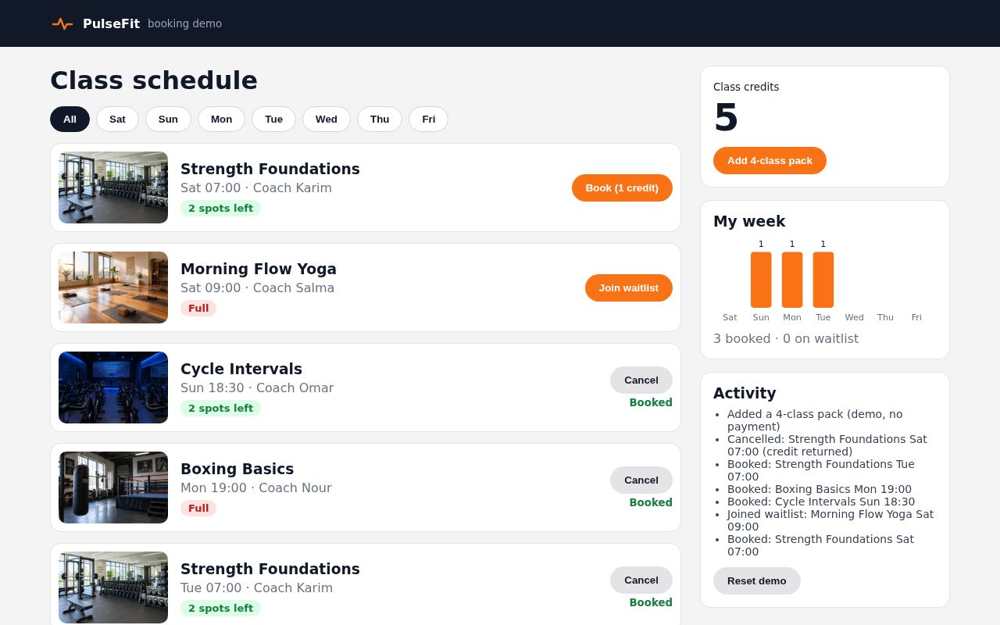
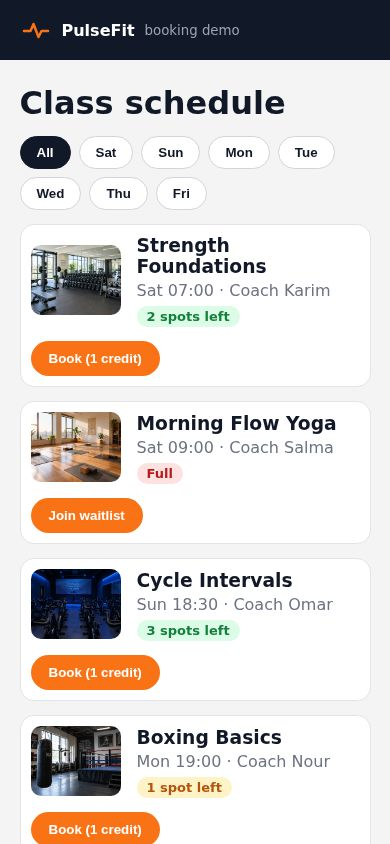

# PulseFit Booking (React + Vite)

A class-booking demo for a fictional gym. Coaches, classes and the gym are invented. Photos are AI-generated. No payments are made.

## Features
- Weekly class schedule with day filter and live spots left
- Book with class credits (1 credit per class); a full class offers a waitlist
- Cancel returns the credit; leave the waitlist at any time
- "My week" bar chart (SVG) and an activity log
- Add a 4-class pack (demo only, no payment), reset demo data
- State is kept in the browser (localStorage)

## Run
```bash
npm install
npm run dev
npm run build
```

## Demo video
[docs/demo.mp4](docs/demo.mp4) (short screen recording of the main flows)

## Preview



## Tests
Headless Chrome checks (24): booking and credit counts, spots left, full class waitlist, no booking without credits, persistence after reload, cancel refund, leave waitlist, credit pack, day filter, chart, reset, mobile overflow, console errors.
